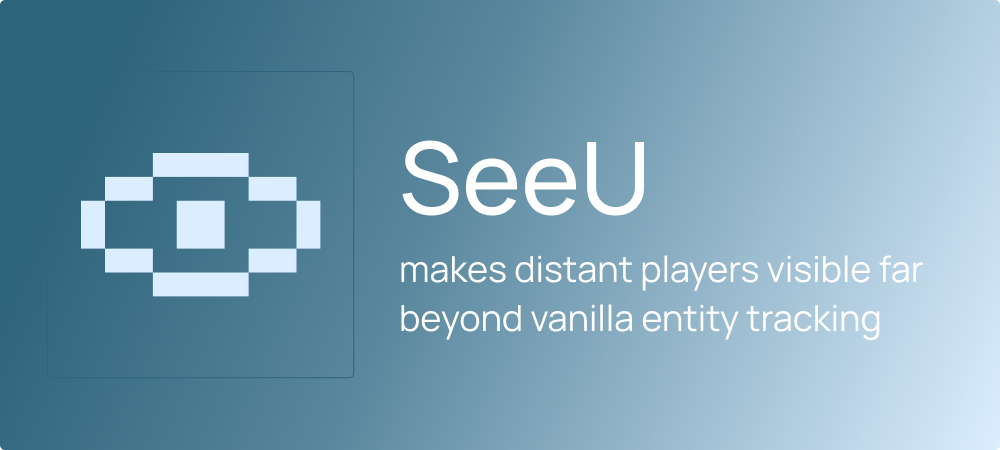

Discuss SeeU on [Discord](https://discord.gg/fQqJsPmQrP).

## SeeU

The `26.3` branch contains the Fabric, NeoForge, and Paper builds for Minecraft `26.3`. Build all platforms together with `./gradlew build`.

SeeU renders players beyond vanilla's entity-tracking range. A `Paper`, `Fabric`, or `NeoForge` server sends player snapshots to a `Fabric` or `NeoForge` client. After vanilla stops rendering a player, the client replaces that entity with a remote-player proxy that retains:

- pose, yaw, pitch, and name
- held items and armor
- the ridden entity, such as a boat

Each player controls whether the server shares their proxy and the proxy's maximum viewing distance.

SeeU provides an addon bus on Fabric and NeoForge. Addons negotiate their own protocol through SeeU and send bounded payloads over SeeU-owned channels. One failing addon closes its own session without closing SeeU or another addon.

## Requirements

- Minecraft `26.3`
- Java `25`
- `Fabric` or `NeoForge` client
- `Paper` plugin, Fabric server mod, or NeoForge server mod

Install the matching client and server JARs from the same SeeU release. Join the server, then move beyond vanilla's player-rendering range. `Voxy` and `Distant Horizons` are optional terrain mods; SeeU renders the player proxies.

The default schedule sends player movement every two server ticks. The client adjusts interpolation to the received cadence and snaps teleports of 32 blocks or more. Servers that kept the old ten-tick value migrate to two ticks; custom intervals stay unchanged.

## SeeU Extra

[SeeU Extra](https://github.com/cat4blep/SeeU-Extra) is a separate Fabric and NeoForge addon for non-player entities. Install it with SeeU on the modded server and each client. Paper stays player-only and does not support SeeU Extra.

## Settings

The settings key is unbound by default. Assign it under **Options > Controls > Key Binds**. Existing key assignments are preserved. On Fabric, Mod Menu adds a **Configure** button to the SeeU entry. On NeoForge, open **Mods > SeeU > Config**.

- enable distant-player rendering
- set local render and animation distances
- set the handoff distance from vanilla entities to proxies
- show or hide distant-player name tags
- allow or block sharing your proxy
- limit how far other players can receive your proxy

With Sodium 0.9.2 or newer for this Minecraft version, these settings also appear on the **SeeU > Distant players** page in **Options > Video Settings**. Apply saves the changes; Undo or Escape discards them. Sodium is optional. The integration uses its [Config API](https://github.com/CaffeineMC/sodium/wiki/CaffeineMC-Maven-%26-Config-API).

The client sends changes to the server without a reconnect.

When using Sodium's search, clear the search before reducing the maximum render distance. If the dependent distance sliders show pending changes after Apply, clear the search and apply once more. The saved settings remain valid.

## Config files

- Fabric client: `config/seeu-client.json`
- Fabric server: `config/seeu-server.json`
- NeoForge client and server: `config/seeu-client.json`, `config/seeu-server.json`
- Paper: `plugins/SeeU/config.yml`

## Limits

- SeeU creates proxies for players and their ridden entities.
- Player protocol version `5` requires matching client and server/plugin updates.
- A client without a server sender receives no player snapshots.
- The addon bus accepts up to 32 addons, 32 KiB handshakes, and 1 MiB messages. Each addon can declare a smaller message limit.

## Build

```powershell
./gradlew build
```

Gradle writes the JARs to:

- `fabric/build/libs/seeu-fabric-<version>.jar`
- `neoforge/build/libs/seeu-neoforge-<version>.jar`
- `paper/build/libs/seeu-paper-<version>.jar`
- `addon-api/build/libs/seeu-addon-api-<minecraft-version>-<version>.jar`

## License

See [LICENSE](LICENSE). The project uses `LicenseRef-SeeU-Restricted-1.0`.
